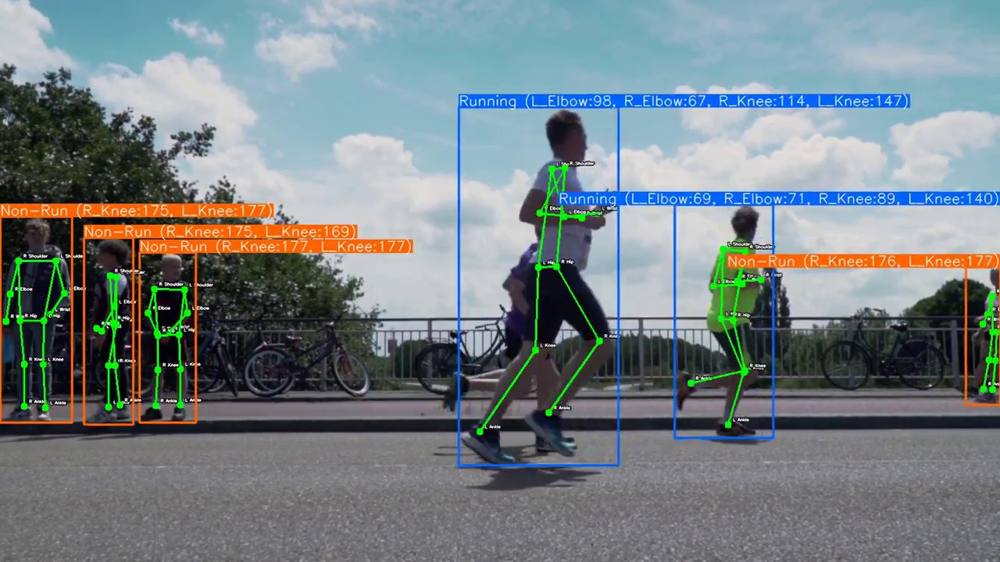
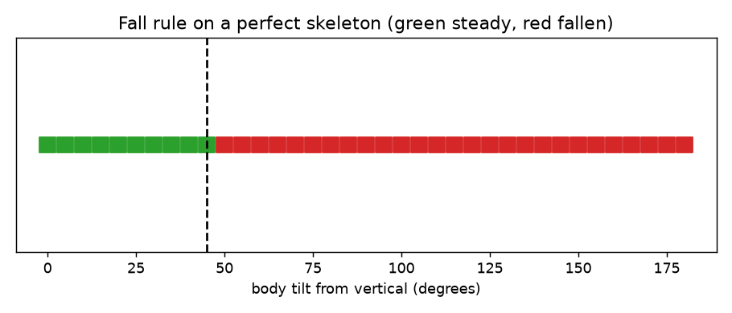

# Pose-Based Safety Monitoring


**Problem:** in a camera feed, flag people who may need attention (someone who has fallen, someone running in a crowd) without training a new model: take the 2D body keypoints a YOLO pose model already gives you and apply simple, inspectable geometric rules.

The value of this repo is the rules themselves: they are pure functions of 17 keypoints, so they run without a GPU or a video, are unit tested, and their behaviour on edge cases is documented below.

| Demo: fall detection | Demo: running vs non-running |
|---|---|
|  |  |

(Frames from the original demo videos; the videos themselves are not in the repo.)

## The rules

| Module | Question | Rule |
|---|---|---|
| [`posture/fall.py`](posture/fall.py) | Has this person fallen? | Line from shoulder midpoint to knee midpoint (hips if knees are hidden). Shallower than 45 degrees from horizontal (`abs(slope) < 1`) means *fallen*. Both knees (or ankles) above the shoulders means *inverted, fallen*. Shoulders or hips not visible means *unknown*. |
| [`posture/movement.py`](posture/movement.py) | Is this person running? | *Running* if at least one elbow angle is below 130 degrees and at least one knee angle is below 160 degrees; *non-running* if both legs are visible and that does not hold; otherwise *unknown*. |
| [`posture/visibility.py`](posture/visibility.py) | How much of this person can the model see? | Fraction of the 12 body joints above the confidence threshold. |

Keypoints use the COCO-17 layout; coordinates are image coordinates (y down).

## How the fall rule behaves

There is no labelled video in this repo, so no accuracy number is claimed. Instead [`run_analysis.py`](run_analysis.py) feeds the rule a perfect synthetic skeleton, tilted from upright to upside down, and records the verdict.



- The switch happens exactly where designed: steady up to 45 degrees of tilt (slope 1.00), fallen from 50 degrees onward. Between 130 and 180 degrees the verdict comes from the inverted check instead of the slope.
- Hidden joints are handled conservatively: with both hips hidden the person is `unknown`, not `fallen` (`results/fall_occlusion_cases.csv`).

### Known weaknesses (not fixed)

- The rule uses the **2D image slope**. A person who falls toward or away from the camera foreshortens: the torso line stays steep and the fall is missed. A camera mounted high looking down has the same problem.
- Someone deliberately lying down (sunbathing, sleeping, doing push-ups) is also "fallen". The rule has no notion of time, so it cannot tell a fall (a fast transition) from lying still.
- A person bending over to pick something up can pass through shallow angles and trigger a false alarm.
- Thresholds (0.7 joint confidence, slope 1.0) were set by eye on a few demo videos, not tuned on labelled data.

A sound next step is to evaluate on a labelled fall dataset and add a temporal rule (a steady-to-fallen transition within about a second, followed by stillness).

## Changes from the earlier separate repos

This repo replaces `YOLO-Falling-Detection`, `YOLO-MovementType-Detection` and `YOLO-Amputee-Detection`.

- The logic moved out of 250-line video scripts into testable functions.
- **The inverted-posture check was changed.** It originally compared the knees against the lowest torso joint, including hips, so a person *sitting* with raised knees was flagged as fallen. It now compares against the shoulders, and a test covers the sitting case.
- **The "disabled / amputee" detector was dropped, not ported.** It labelled a person "disabled" whenever any body joint had low confidence. Low confidence overwhelmingly means occlusion, a frame edge or a bad frame, so the labels were wrong in principle, and inferring disability from a camera is not something this kind of rule can or should do. The signal is kept as a visibility score, which says how far to trust the other rules for that person.

## Run it

Rules and tests need only numpy:

```bash
python -m venv .venv && source .venv/bin/activate   # Windows: .venv\Scripts\activate
pip install -r requirements.txt
pytest                      # 19 tests
python run_analysis.py      # regenerates results/
```

To annotate a video (needs ultralytics and OpenCV; the model weights are downloaded by ultralytics on first use):

```bash
pip install -r requirements-video.txt
python run_video.py input.mp4 output.mp4 --mode fall        # or --mode movement
```

## Layout

```
posture/
  keypoints.py   COCO-17 indices, visibility helper
  fall.py        fall / inverted-posture rule
  movement.py    running vs non-running from joint angles
  visibility.py  per-person visibility score
  synthetic.py   synthetic skeleton for tests and sensitivity analysis
  video.py       YOLO pose + OpenCV video runner (optional dependencies)
run_analysis.py  sensitivity analysis -> results/
run_video.py     command line for annotating a video
tests/           19 unit tests
```
