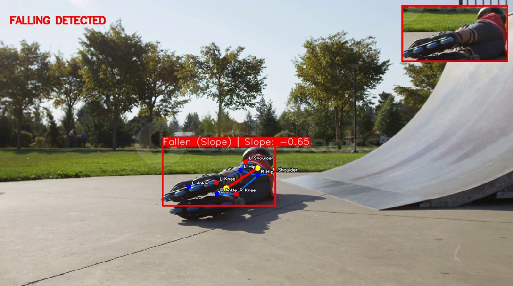

# Fall Detection from Pose Keypoints


**Problem:** in a camera feed, flag a person who has fallen, without training a new model: take the 2D body keypoints a YOLO pose model already gives you and apply a simple, inspectable geometric rule.

The value of this repo is the rule itself. It is a pure function of 17 keypoints, so it runs without a GPU or a video, is unit tested, and its behaviour on edge cases is documented below.



(Frame from the original demo video; the video itself is not in the repo.)

## The rule

[`posture/fall.py`](posture/fall.py) classifies each person as `steady`, `fallen` or `unknown`:

1. Draw a line from the shoulder midpoint to the knee midpoint (hip midpoint if the knees are hidden).
2. If that line is shallower than 45 degrees from horizontal (`abs(slope) < 1`), the person is **fallen**; otherwise **steady**.
3. If both knees (or both ankles) are higher in the image than the shoulders, the person is **inverted**, counted as **fallen**.
4. If the shoulders or hips are not visible, the answer is **unknown**, never a guess.

Keypoints use the COCO-17 layout; coordinates are image coordinates (y down). [`posture/visibility.py`](posture/visibility.py) adds a per-person score for how many body joints the model actually saw, so a downstream system can weigh the verdict.

## How the rule behaves

There is no labelled video in this repo, so no accuracy number is claimed. Instead [`run_analysis.py`](run_analysis.py) feeds the rule a perfect synthetic skeleton, tilted from upright to upside down, and records the verdict.


- The switch happens exactly where designed: steady up to 45 degrees of tilt (slope 1.00), fallen from 50 degrees onward. Between 130 and 180 degrees the verdict comes from the inverted check instead of the slope.
- Hidden joints are handled conservatively: with both hips hidden the person is `unknown`, not `fallen` ([`results/fall_occlusion_cases.csv`](results/fall_occlusion_cases.csv)).

### Known weaknesses (not fixed)

- The rule uses the **2D image slope**. A person who falls toward or away from the camera foreshortens: the torso line stays steep and the fall is missed. A camera mounted high looking down has the same problem.
- Someone deliberately lying down (sleeping, sunbathing, doing push-ups) is also "fallen". The rule has no notion of time, so it cannot tell a fall (a fast transition) from lying still.
- A person bending over to pick something up can pass through shallow angles and trigger a false alarm.
- Thresholds (0.7 joint confidence, slope 1.0) were set by eye on a few demo videos, not tuned on labelled data.

A sound next step is to evaluate on a labelled fall dataset and add a temporal rule (a steady-to-fallen transition within about a second, followed by stillness).

## Changes from the earlier repo

This repo replaces `YOLO-Falling-Detection`.

- The logic moved out of a 250-line video script into testable functions.
- **The inverted-posture check was changed.** It originally compared the knees against the lowest torso joint, including hips, so a person *sitting* with raised knees was flagged as fallen. It now compares against the shoulders, and a test covers the sitting case.

## Run it

The rule and tests need only numpy:

```bash
python -m venv .venv && source .venv/bin/activate   # Windows: .venv\Scripts\activate
pip install -r requirements.txt
pytest                      # 15 tests
python run_analysis.py      # regenerates results/
```

To annotate a video (needs ultralytics and OpenCV; the model weights are downloaded by ultralytics on first use):

```bash
pip install -r requirements-video.txt
python run_video.py input.mp4 output.mp4
```

## Layout

```
posture/
  keypoints.py   COCO-17 indices, visibility helper
  fall.py        fall / inverted-posture rule
  visibility.py  per-person visibility score
  synthetic.py   synthetic skeleton for tests and sensitivity analysis
  video.py       YOLO pose + OpenCV video runner (optional dependencies)
run_analysis.py  sensitivity analysis -> results/
run_video.py     command line for annotating a video
tests/           15 unit tests
```
